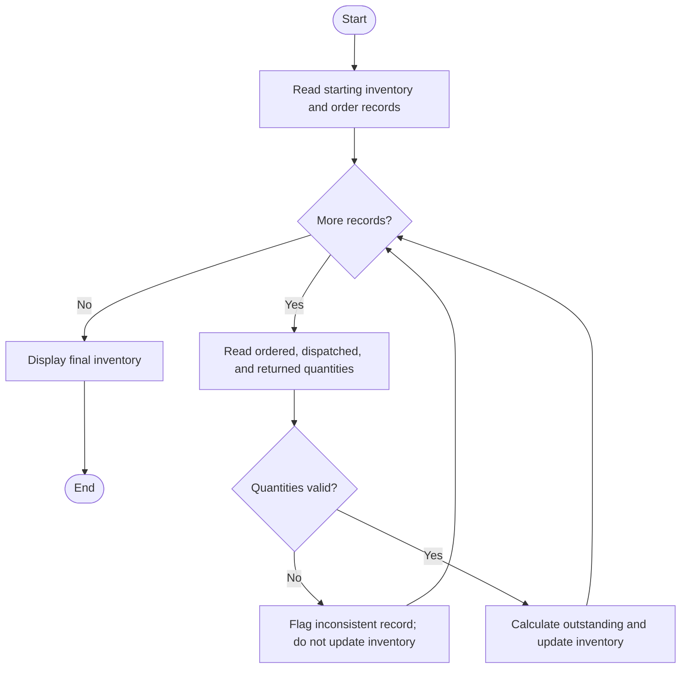

# Retail Order Dispatch and Return Analysis

## Problem statement

Process each order’s ordered, dispatched, and returned quantities. Calculate the outstanding quantity, update inventory for valid dispatches and returns, and flag records that are inconsistent.

Assume:

- Dispatching an item reduces inventory.
- Returning an item increases inventory.
- Returned quantity cannot exceed dispatched quantity.
- Dispatched quantity cannot exceed ordered quantity.
- Quantities must be non-negative.
- An inconsistent record does not change inventory.

## Algorithm

1. Read the starting inventory and each order’s ID, ordered quantity, dispatched quantity, and returned quantity.
2. Check that quantities are non-negative, dispatched quantity does not exceed ordered quantity, and returned quantity does not exceed dispatched quantity.
3. For a valid record:
   - Calculate outstanding quantity as `ordered - dispatched`.
   - Update inventory as `inventory - dispatched + returned`.
4. For an invalid record, report the issue and leave inventory unchanged.
5. Display each order’s status and the final inventory.

## Flowchart

flowchart TD
    A([Start]) --> B[Read starting inventory and order records]
    B --> C{More records?}
    C -- No --> H[Display final inventory]
    H --> I([End])
    C -- Yes --> D[Read ordered, dispatched, and returned quantities]
    D --> E{Quantities valid?}
    E -- No --> F[Flag inconsistent record; do not update inventory]
    E -- Yes --> G[Calculate outstanding and update inventory]
    F --> C
    G --> C


## Sample input

```text
Enter starting inventory: 100
Enter number of orders: 3
Order ID: ORD101
Ordered quantity: 10
Dispatched quantity: 8
Returned quantity: 1
Order ID: ORD102
Ordered quantity: 5
Dispatched quantity: 6
Returned quantity: 0
Order ID: ORD103
Ordered quantity: 7
Dispatched quantity: 4
Returned quantity: 2
```

## Sample output

```text
Order analysis
ORD101: OK, outstanding=2, inventory=93
ORD102: INCONSISTENT, issues=dispatched quantity exceeds ordered quantity, inventory unchanged at 93
ORD103: OK, outstanding=3, inventory=91

Final inventory: 91
```

## Mermaid flowchart code

The flowchart above is Mermaid code. You can copy this version into a Mermaid-compatible editor:


