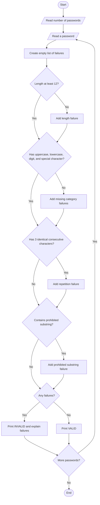

## Problem statement

Create a Python program that checks each sample password against these rules:

- At least **12 characters** long.
- Contains at least one **uppercase letter**, **lowercase letter**, **digit**, and **special character**.
- Does not contain the same character **three or more times in a row**.
- Does not contain a prohibited substring: `password`, `admin`, or `qwerty` (case-insensitive).

The program must report every failed condition for each password.

## Algorithm

1. Read the number of passwords and then read each password.
2. For each password, check its length and whether it contains each required character category.
3. Find any run of three or more identical consecutive characters.
4. Search for prohibited substrings without considering letter case.
5. Report whether the password is valid. If it is invalid, list every failed condition.


## Sample input

```text
4
Abc1!xyz
GoodPassword1!
AAAbcdef1!
Strong#River42
```

## Sample output

```text
Password 1: INVALID
  - Length is 8; minimum required is 12.
Password 2: INVALID
  - Contains prohibited substring 'password'.
Password 3: INVALID
  - Length is 10; minimum required is 12.
  - Character 'A' repeats 3 or more times in a row.
Password 4: VALID
```

## Mermaid flowchart code


